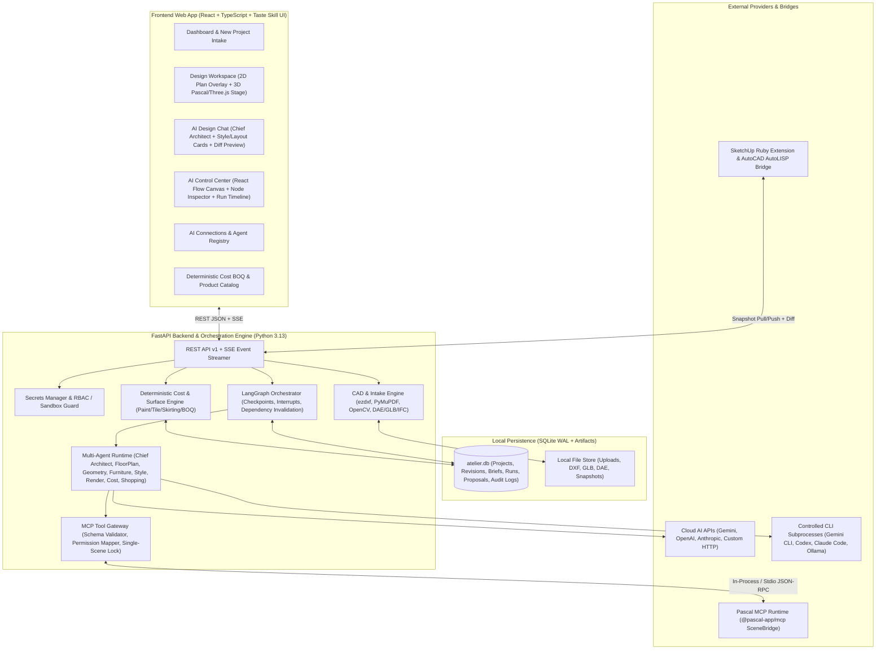

# ATELIER AI — System Architecture & Technical Design

## 1. Executive Summary

**ATELIER AI — Intelligent Interior Design Studio** is a production-grade, AI-orchestrated architectural and interior design platform built on top of the open-source **Pascal Editor** (`@pascal-app/core`, `@pascal-app/viewer`, `@pascal-app/nodes`, `@pascal-app/mcp`, `@pascal-app/ifc-converter` — MIT License), borrowing deterministic vector/raster floor-plan reconciliation patterns from **House Plan Designer** (`ZWD11/house-plan-designer` — MIT License) and following the **Taste Skill** (`Leonxlnx/taste-skill` — MIT License) white architectural studio design system.

### Core Architectural Principles
1. **Single Source of Truth (`CanonicalProjectSchema` ↔ `PascalSceneGraph`)**: All geometry is stored in a versioned canonical model in **millimeters (`mm`)** and mapped bidirectionally to Pascal's meter-based (`m`, right-handed `[x, z]` ground plane, `+Y` up) scene graph. AI renders are strictly visual references and never overwrite canonical geometry.
2. **2D-First & Low-Spec Hardware Friendly**: Built to run smoothly on 8 GB RAM laptops with integrated GPUs (Intel Iris Xe / UHD). The 2D architectural SVG/Canvas floor plan and surface editor load immediately with zero GPU overhead; the 3D viewer (`@pascal-app/viewer` / Three.js) is lazy-loaded on demand with hardware capability detection (WebGPU with automatic WebGL2 fallback, DPR capping at `1.5`, on-demand frame rendering, and low-poly procedural/catalog meshes).
3. **Conversational Multi-Agent Studio with Human-in-the-Loop (HITL)**: Led by the **Chief Architect / Design Concierge**, specialized agents (`FloorPlan`, `Geometry`, `Furniture`, `Style & Surface`, `Render`, `Cost`, `Shopping`, `Critic`) collaborate via LangGraph / structured state machine checkpoints. Every destructive or budget-impacting mutation produces a **Scene Proposal & Diff** (`WAITING_FOR_APPROVAL`) requiring user preview and explicit **Approve / Reject / Edit** action with optimistic concurrency control (`scene_revision`).
4. **Deterministic Surface & Cost Engineering**: Paint, tiles, flooring, skirting, and furnishings are calculated deterministically using exact geometric formulas (wall net area minus openings and tile zones, tile box rounding `ceil`, waste rates by layout pattern, primer + topcoat liter conversion) backed by source-verified catalog quotes (`data/seed/`). LLMs are never used for arithmetic.

---

## 2. Environment & Reference Repository Audit (Phase 0 Findings)

### 2.1 Host Hardware & Runtime Verification
| Component | Detected Specification | Impact & Design Decision |
|---|---|---|
| **OS** | Windows 10/11 x64 | Provide native PowerShell (`start-atelier.ps1`) and cross-platform scripts. |
| **CPU & RAM** | 12 Logical Processors, ~14.8 GB RAM | Target <= 8 GB RAM footprint: single FastAPI process + SQLite WAL + Vite React SPA. |
| **GPU** | Intel Iris Xe Graphics + USB Mobile Monitor Virtual Display | Must support WebGPU where available AND graceful WebGL2 / 2D-first fallback so virtual/iGPU displays never crash. |
| **Node.js** | `v22.19.0` (`npm 10.9.3`, `pnpm 12.14.0`) | Note: `@pascal-app/*@1.0.7` declares `engines.node: "^22.23.4"`. We use `--engine-strict=false` and provide a verified Node/Python MCP bridge. |
| **Python** | `Python 3.13.7` | Verified installed: `fastapi 0.142.2`, `pydantic 2.12.5`, `langgraph 0.6.11`, `mcp 1.28.1`, `ezdxf`, `pymupdf`, `opencv-python`, `shapely`, `google-genai`, `openai`, `anthropic`, `ollama`, `playwright`, `openpyxl`. |

### 2.2 Reference Repositories & License Verification
| Repository | Version / Commit Audited | License | What We Reuse / Adapt | Verified Limitations |
|---|---|---|---|---|
| [`pascalorg/editor`](https://github.com/pascalorg/editor) | `@pascal-app/*@1.0.7` | **MIT** (Copyright 2026 Pascal Group Inc.) | Node schemas (`Site`, `Building`, `Level`, `Wall`, `Slab`, `Ceiling`, `Zone`, `Door`, `Window`, `Item`), `Wall.slots` (`a`, `b`, `aSkirting`, `bSkirting`), `Wall.faceRegions`, `Zone.floor`, MCP tool contracts (`create_room`, `add_wall`, `add_door`, `add_window`, `place_items`, `paint`, `verify_scene`, `check_collisions`), browser GLB/IFC export pipelines. | Headless `export_glb` in `@pascal-app/mcp` throws `not_implemented` by design — GLB/IFC/DAE exports MUST run through the browser viewer or verified mesh builder. Local MCP shares scene state per process — requires a managed single-gateway mutex. |
| [`ZWD11/house-plan-designer`](https://github.com/ZWD11/house-plan-designer) | `main` (2026) | **MIT** (Copyright 2026 ZWD11) | Multi-route floor plan intake concepts (`cadvec` vector PDF/DXF extraction, raster wall-pair & dimension tick calibration), 3-way reconciliation checks (wall audit, dimension chain check, furniture clearance/door-swing check), GB/VN CAD layer conventions. | Original repo generates standalone 1MB HTML files; we adapt its algorithmic intake and audit rules into our FastAPI `cad` and `intake` modules targeting `CanonicalProjectSchema`. |
| [`Leonxlnx/taste-skill`](https://github.com/Leonxlnx/taste-skill) | `tasteskill 2.5.1` (`design-taste-frontend`) | **MIT** (Copyright 2026 Leonxlnx) | Token discipline, 4/8 spacing scale, high-contrast editorial typography (`Inter` / `Geist` + `JetBrains Mono`), quiet micro-interactions (`180ms cubic-bezier(.2,.8,.2,1)`), no neon/purple/glassmorphism slop, strict visual hierarchy, real browser verification across `1440`, `1024`, `768`, `390`. | Adapted specifically for our White Architectural SaaS Studio (`#FFFFFF` canvas, `#F7F8FA` surface, `#E8EAED` border, `#17191C` ink, `#667085` muted, `#276E70` architectural slate-teal accent). |

---

## 3. Monorepo Directory Structure

```text
c:/Users/TUAN/Downloads/qldapm_fina/
├── apps/
│   ├── web/                        # React 19 + TypeScript + Vite + Tailwind/CSS Variables (Taste Skill UI)
│   │   ├── src/
│   │   │   ├── components/         # Layout, 2D/3D Stage, AI Chat Concierge, React Flow Canvas, Modals
│   │   │   ├── pages/              # Dashboard, Import, Workspace, ControlCenter, Agents, Styles, Renders, Costs, Catalog, CAD, Settings
│   │   │   ├── store/              # Zustand stores (project, scene, chat, workflow, hardware profile)
│   │   │   ├── lib/                # API client, SSE subscriber, GLB/DAE/IFC/DXF browser exporters
│   │   │   └── styles/             # Taste Skill white studio design tokens & layout system
│   └── api/                        # Python FastAPI + LangGraph Orchestrator + MCP Gateway + SQLite
│       ├── app/
│       │   ├── main.py             # FastAPI entrypoint, CORS, static mounts, lifespan
│       │   ├── db.py               # SQLite WAL engine, schema migrations, repository adapters
│       │   ├── models/             # Pydantic v2 contracts (Canonical Schema, Chat, Workflow, Agents, Pricing)
│       │   ├── routers/            # REST & SSE endpoints (/projects, /chat, /workflows, /agents, /connections, /exports)
│       │   ├── services/
│       │   │   ├── mcp_gateway.py  # Managed Pascal MCP Server & Tool Gateway (in-memory + stdio/HTTP bridge)
│       │   │   ├── orchestrator.py # LangGraph / State Machine workflow engine with HITL interrupts & checkpoints
│       │   │   ├── agents.py       # Chief Architect + 7 Specialist Agents (API / CLI / Custom / Local Ollama)
│       │   │   ├── intake.py       # DXF (ezdxf), PDF (PyMuPDF), Raster (OpenCV) floor plan parser & scale calibrator
│       │   │   ├── geometry.py     # Canonical <-> Pascal bidirectional adapter, AABB/OBB collision & clearance audit
│       │   │   ├── cost_engine.py  # Deterministic surface & BOQ calculator (Paint, Tiles, Furniture, Labor, Waste)
│       │   │   └── cad_export.py   # Bidirectional DXF R2007 exporter/importer, GLB/DAE/IFC converters
├── packages/
│   ├── contracts/                  # Shared JSON Schemas & TypeScript/Python contract definitions
│   ├── pascal-adapter/             # Node.js / TypeScript Pascal MCP & SceneBridge runner script + mapper
│   ├── workflow/                   # Default workflow graph templates & validation rules
│   └── cad/                        # SketchUp Ruby Extension (.rb) & AutoCAD AutoLISP (.lsp) bridge plugins
├── data/
│   └── seed/
│       ├── materials_vn.json       # Surface library: Paints (Dulux/Jotun), Tiles (Viglacera/Dong Tam), Wood Flooring
│       ├── catalog_vn.csv          # Furniture & fixtures catalog with dimensions, source URLs, timestamps (ILLUSTRATIVE)
│       └── sample_4x5m.dxf         # Reference 4x5m room DXF (mm) for round-trip verification
├── docs/                           # Architecture, Data Model, Workflow Schema, CAD Integration, Status, Limitations
└── tests/                          # Pytest & Playwright verification suite (10 mandatory acceptance scenarios)
```

---

## 4. High-Level System Architecture


