# ATELIER AI — Workflow & Multi-Agent Orchestration Schema

## 1. LangGraph / State Machine Pipeline

ATELIER AI executes a checkpointed, human-in-the-loop (HITL) graph where nodes represent either **AI Agents**, **Pascal MCP Operations**, **Deterministic Engines**, or **Human Gates**:

```mermaid
flowchart LR
    Trigger["Trigger / Upload"] --> Validate["Input Validation"]
    Validate --> FloorPlan["Floor Plan Agent"]
    FloorPlan --> AskScale{"Scale Known?"}
    AskScale -- "No (Interrupt)" --> ConfirmScale["Scale Confirmation (HITL)"]
    AskScale -- "Yes" --> Geometry["Geometry Agent (Pascal MCP)"]
    ConfirmScale --> Geometry
    Geometry --> Brief["Chief Architect Interview"]
    Brief --> Furniture["Furniture & Layout Agent (Options A/B)"]
    Furniture --> Style["Style & Surface Advisor (Paint/Tile)"]
    Style --> Approval1["User Proposal Approval (HITL)"]
    Approval1 --> Cost["Deterministic Cost Engine"]
    Cost --> Shopping["Shopping & Fit-Check Agent"]
    Style --> Render["Render Agent (Cloud Visualization)"]
    Shopping --> Export["CAD / BOQ Export"]
```

## 2. Dependency Invalidation Matrix (Selective Re-run)

When a user changes a design decision mid-stream, the orchestrator **only invalidates downstream dependent nodes** instead of re-running floor plan parsing or wall geometry:

| User Change Event | Invalidated & Re-run Nodes | Preserved Nodes (Not Re-run) |
|---|---|---|
| **Change Paint Color / Tile Pattern** | `StyleAdvisor` → `CostEngine` → `RenderAgent` (optional) | `FloorPlan`, `ConfirmScale`, `Geometry`, `Furniture` |
| **Swap Sofa / Resize Furniture** | `FurnitureAgent` (collision check) → `Approval` → `CostEngine` → `ShoppingAgent` | `FloorPlan`, `ConfirmScale`, `Wall Geometry` |
| **Change Style (e.g. Modern → Japandi)** | `StyleAdvisor` → `FurnitureAgent` (material slots) → `CostEngine` → `ShoppingAgent` | `FloorPlan`, `ConfirmScale`, `Wall Geometry` |
| **Modify Wall / Door / Scale** | `GeometryAgent` → `FurnitureAgent` → `StyleAdvisor` → `CostEngine` → `ShoppingAgent` | `Intake Upload` |

## 3. Workflow Node Inspector Schema

Every node in the **AI Control Center** (React Flow canvas) persists its configuration in `workflow_definitions`:
- `node_id`, `type` (`trigger`, `validation`, `floor_plan_agent`, `scale_confirmation`, `geometry_agent`, `furniture_agent`, `style_advisor`, `user_approval`, `render_agent`, `cost_engine`, `shopping_agent`, `export_job`, `conditional_router`, `error_handler`)
- `execution_kind`: `"llm_agent" | "mcp_tool" | "deterministic" | "human_gate" | "conversion_job"` (explicitly badged in UI so deterministic nodes are never misrepresented as AI)
- `agent_id`: Link to `AgentRegistry`
- `system_prompt`, `provider`, `model`, `temperature`, `max_tokens`
- `allowed_tools`: Array of MCP tool names (`create_room`, `add_wall`, `place_items`, `paint`, etc.)
- `timeout_sec`, `retry_count`, `cost_budget_usd`, `approval_required`, `enabled`

## 4. Run States & Concurrency Rules
- **Run States**: `IDLE`, `RUNNING`, `WAITING_FOR_INPUT` (`ask_user` blocking question), `WAITING_FOR_APPROVAL` (scene diff pending user decision), `PAUSED` (checkpointed), `COMPLETED`, `FAILED`, `CANCELLED`.
- **Single-Scene Lock**: Only one heavy AI or MCP mutation job mutates a project's Pascal scene at a time. Proposals record `base_revision`; applying a proposal verifies `project.revision == proposal.base_revision` before committing.
